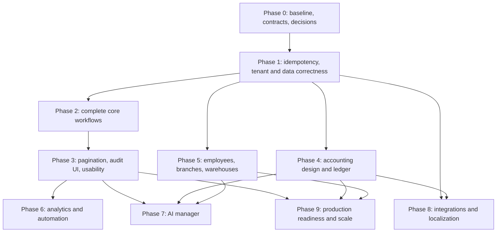

# UBOS Dependency Graph

## Phase-level order

The diagram shows minimum dependencies, not a requirement to wait on unrelated work. Production preparation can begin early as discovery, but production readiness cannot be claimed until critical data and operational controls are complete.

## Work-item dependencies

| Work item | Depends on | Parallelizable? | Shared-file/schema caution |
|---|---|---|---|
| Define PATCH clear semantics and fix route IDs | Phase 0 contract review | Yes, independently of costing decisions | Same controllers/DTOs/services; keep one owner per API slice |
| Durable idempotency | Replay response/retention decision | Partly; design can parallelize, schema/service implementation is coupled | Same service transaction and new table/migration; coordinate with stock and payment changes |
| Tenant composite constraints | Relationship inventory + read-only data audit | Audit can parallelize; migration must follow remediation | Prisma schema and migration shared by all DB tasks; serialize migrations |
| Multi-line invoice UI | Existing API contract review | UI design can parallelize with backend tests | Avoid concurrent edits to `business-operations.tsx` if other UI work overlaps |
| Invoice lifecycle/reversal | Accounting/product rules | No implementation until decisions | Touches invoice/payment/stock schema and service transactions; high coupling |
| Pagination/search | Stable sort/filter contract | API and UI design can parallelize; integration must align | Shared list DTO/service/UI; schema indexes should follow query review |
| Audit history UI/API | Audit privacy/retention policy and `audit.read` contract | UI mock/design can parallelize; API and UI integration coupled | New controller/service plus shared nav/component changes |
| Costing method | Accounting approval and opening-stock policy | Research/options comparison can parallelize | Schema and purchase/report logic changes; do not overlap uncoordinated with procurement work |
| GL/accounting | Core lifecycle, payment allocation, costing/tax/period decisions | Requirements can parallelize; implementation should be vertical slices | New schema, APIs, permissions, reports; serialize migrations and reconciliation changes |
| Branch/warehouse scope | Location hierarchy and role matrix | Product discovery can parallelize | Cross-cuts guards, every relevant query, inventory schema; avoid piecemeal enforcement |
| AI actions | Audit, permissions, stable commands, approvals | Read-only UX discovery can parallelize | Never bypass business services; coordinate tool authorization and audit schema |
| Integrations | Idempotency, audit, provider/security choice | Provider research can parallelize | Webhook tables, credentials, retries and source-event contracts are coupled |
| Production readiness | Deployment target, RPO/RTO, critical workflow gates | Discovery and CI groundwork can start early | Migration and runtime config sequencing must be coordinated |

## Product decision gates

Resolve before implementation: costing policy; accounting basis; tax/jurisdiction behavior; invoice post/void/reversal lifecycle; payment allocation and unapplied credit; branch vs warehouse hierarchy; audit retention; idempotency replay semantics; currency conversion source and rounding. Unknowns stay explicit rather than being turned into hidden defaults.

## Parallel execution rule

Parallelize independent research, test design, and documentation. Do not parallelize edits to the same service/controller/UI file or Prisma schema/migration chain. Assign one migration sequence owner; merge schema decisions before dependent API and UI work.
